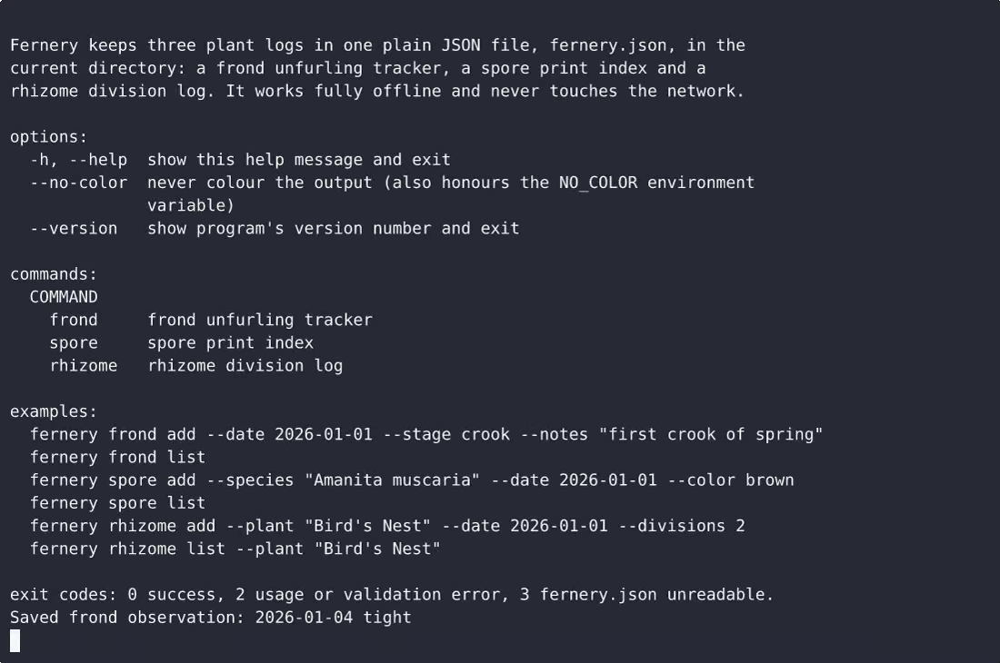
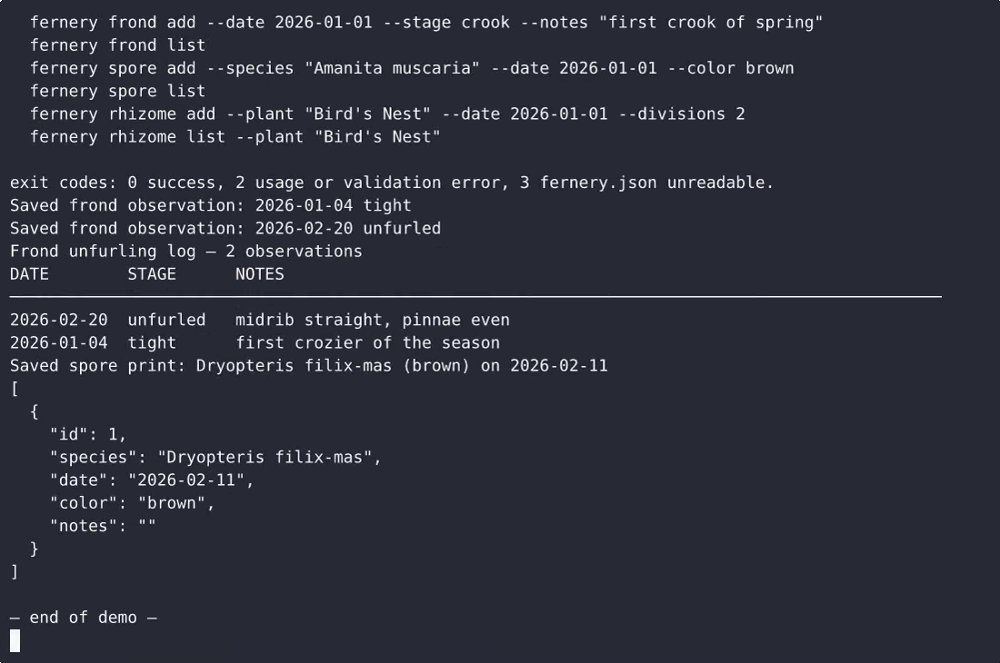

# Fernery — complete Full-stack app command-line tool example app

**Fernery** gives you two paths: self-host the Apache-2.0-licensed Full-stack app source as your own command-line tool, or [open it on cenius.ai](https://cenius.ai/marketplace/p/fernery?ref=gh&utm_campaign=fernery-webapp), describe the changes you want, and receive a new Fernery build with full rebrand rights. Fernery is a single-file, stdlib-only Python CLI for local fern care records: frond unfurling stages, spore print listings, and rhizome division logs. Everything ships in this repo — no paywall, no hidden features, no separate Fernery download.


[](LICENSE)  [](https://cenius.ai)

[](https://cenius.ai/marketplace/p/fernery?ref=gh&utm_campaign=fernery-webapp)

> **▶ [Open & edit in cenius.ai](https://cenius.ai/marketplace/p/fernery?ref=gh&utm_campaign=fernery-webapp)** — one click to an editable workspace: describe changes in plain English, get an instant preview, one-click deploy and host. Modifications made on the platform come with full rebrand & relicense rights.

_Local clone? See [Quick start](#quick-start) below. cenius.ai is the zero-setup path._

## Demo


▶ **[Video walkthrough](https://cenius.ai/marketplace/p/fernery?ref=gh&utm_campaign=fernery-webapp)** — see the app in action on the cenius.ai project page · [MP4 file](.github/media/demo.mp4)

## Screenshots

 

## Usage guide

Three logs, six commands, one JSON file. Everything below runs from a directory
of your choosing; `fernery.json` is written there on your first successful
`add`. If you did not run `install.sh`, replace `fernery` with `python3 fernery.py`.

### 1. Frond unfurling tracker

Record each frond as it moves through the five stages - `tight`, `crook`,
`partly`, `unfurled`, `flat`:

```console
$ fernery frond add --date 2026-01-04 --stage tight --notes "first crozier of the season"
Saved frond observation: 2026-01-04 tight

$ fernery frond add --date 2026-02-20 --stage unfurled --notes "midrib straight, pinnae even"
Saved frond observation: 2026-02-20 unfurled

$ fernery frond add --date 2026-03-06 --stage flat
Saved frond observation: 2026-03-06 flat
```

Read the log back - always newest first, ties broken by insertion order so the
same store always prints the same text:

```console
$ fernery frond list
Frond unfurling log — 3 observations
DATE        STAGE      NOTES
────────────────────────────────────────────────────────────────────────────────
2026-03-06  flat
2026-02-20  unfurled   midrib straight, pinnae even
2026-01-04  tight      first crozier of the season
```

With nothing recorded yet, the log tells you how to start:

```console
$ fernery frond list
No fronds recorded yet.
Add the first one with:
  fernery frond add --date 2026-01-01 --stage tight --notes "first frond of the season"
```

A note longer than the column is shortened with an ellipsis so the table never
wraps; the full text is still in `fernery.json`.

### 2. Spore print index

_Full guide: [`USAGE.md`](USAGE.md)_

## Features

- Frond unfurling tracker
- Spore print index
- Rhizome division log

## Quick start

```bash
./install.sh   # installs dependencies + seeds demo data
```

See [`INSTALL.md`](INSTALL.md) for full setup and usage instructions.

## Architecture

A self-contained Full-stack app project (21 files): top-level directories include `tests/`. `install.sh` provisions dependencies and seeds demo data so the app starts with something real to explore. See [`INSTALL.md`](INSTALL.md) for complete setup instructions.

## FAQ

### What's the quickest way to self-host Fernery?

Pull the repo, run `./install.sh`, and you are up — the script installs packages and pre-seeds the database. [`INSTALL.md`](INSTALL.md) covers any platform-specific tweaks.

### How do I make Fernery my own brand?

Rebranding is straightforward under the MIT license — change what you want in the source. Or [open it on cenius.ai](https://cenius.ai/marketplace/p/fernery?ref=gh&utm_campaign=fernery-webapp): the platform handles the changes and grants full rebrand rights on the result.

### Can I change Fernery without writing code?

The easiest route: [visit the project on cenius.ai](https://cenius.ai/marketplace/p/fernery?ref=gh&utm_campaign=fernery-webapp), tell the platform what to change, and collect the updated build. No source-editing needed.

### What is Fernery built with?

Full-stack app. The full source in this repository is exactly what the app runs. Highlights include frond unfurling tracker.

### Is Fernery free for commercial use?

Yes. The code is Apache-2.0-licensed — use it, modify it, and ship it commercially. See [LICENSE](LICENSE).

## License & rebranding

Released under the [Apache License 2.0](LICENSE) (© 2026 Cenius AI) — free for personal and commercial use. The Cenius name/logo are trademarks (see NOTICE).

**Need a customized version?** [Remix this app on cenius.ai](https://cenius.ai/marketplace/p/fernery?ref=gh&utm_campaign=fernery-webapp) — modifications made on the platform come with **full rebrand & relicense rights** over your derivative.

## Built with cenius.ai

This entire application — code, design, seeded demo data — was generated on **[cenius.ai](https://cenius.ai)** from a plain-English description.

- 🚀 [Build your own app on cenius.ai](https://cenius.ai)
- 🎛️ [Remix Fernery on the marketplace](https://cenius.ai/marketplace/p/fernery?ref=gh&utm_campaign=fernery-webapp) — open it in a workspace, prompt for changes, and ship your own version.

More open-source apps: [the Cenius-ai catalog](https://github.com/Cenius-ai) · [showcase index](https://github.com/Cenius-ai/showcase)
